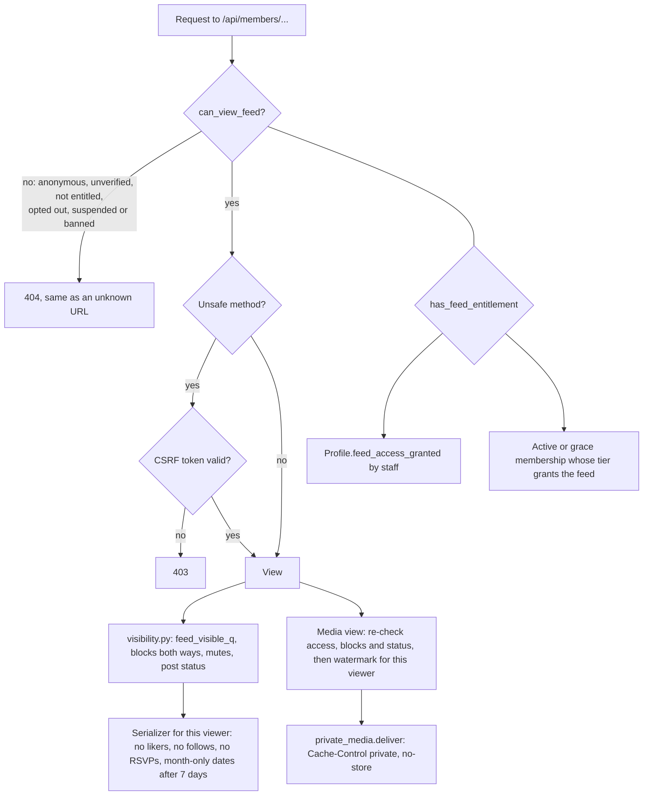
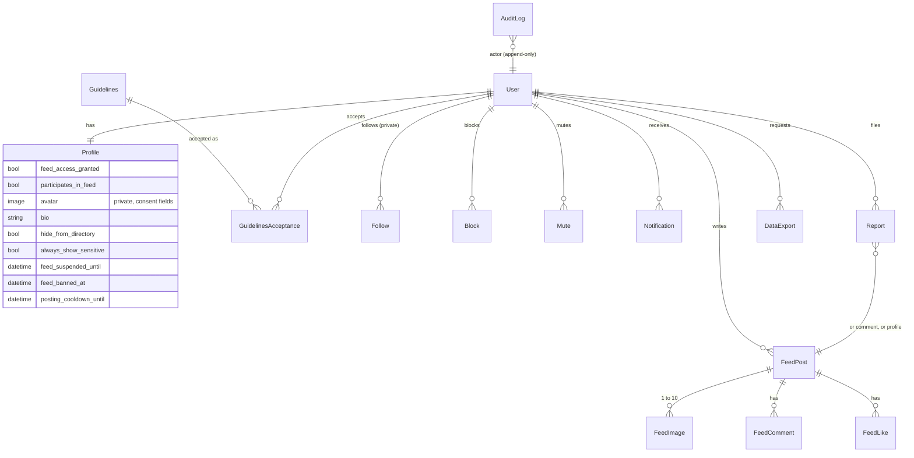
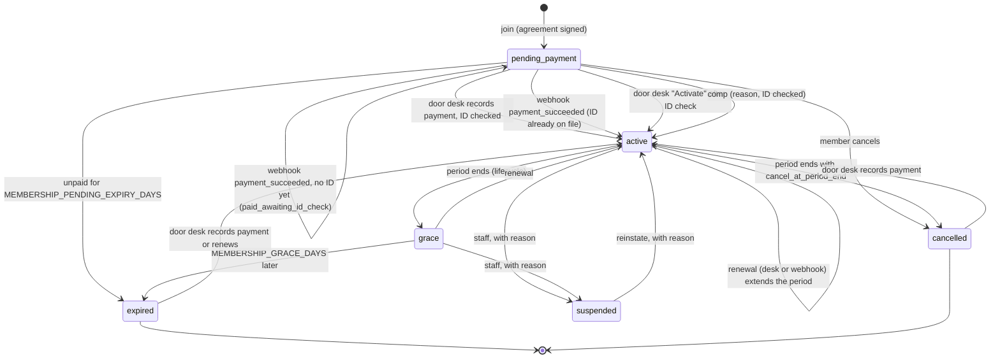
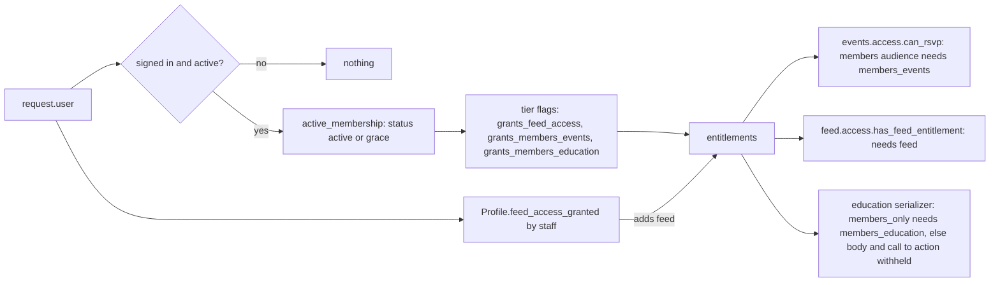

# Architecture

## Overview

```
Browser --> web (gunicorn + Django) -- the built React app (WhiteNoise), /api, the admin, media views
                 |-- Postgres
                 |-- Redis (cache, rate limits, Celery queue)
                 |-- S3 buckets: public (site, journal, event and class images) and
                 |               private (member images, watermarked copies, exports, backups)
                 `-- Celery worker + beat (email, images, reminders, retention, lifecycle, backups)
```

The browser only ever talks to one origin, plus the storage buckets for images. In
production Django serves the built React app itself through WhiteNoise (hashed
`/assets/` with a year-long immutable cache, `index.html` with `no-cache`, both
pre-compressed with gzip and Brotli), so the site, API, admin and media views share
one origin and one set of cookies (`apps/core/spa.py`). The fallback serves `index.html`
for client routes but never for `/api`, the admin, media, static files or anything that
looks like a file. In development the Vite dev server proxies `/api` and `/media` to
Django (`VITE_PROXY_TARGET`). The SPA uses Django session auth with CSRF on every write;
no token is ever stored in browser storage.

One Docker image (`Dockerfile`) runs as the web service, the worker and beat, in two
Render environments (staging and production, `render.yaml`); deployment, storage, email,
security and restores are in `docs/ops/`.

## Backend (`/backend`)

| Path | Purpose |
| --- | --- |
| `config/settings.py` | All settings, read from the environment through django-environ. `DJANGO_ENV` (development, test, e2e, staging, production) turns on HTTPS-only hardening for staging and production. |
| `config/wsgi.py`, `config/celery.py` | Entry points; both run `assert_deploy_safe()` so staging and production refuse to start with an unsafe setting. |
| `gunicorn.conf.py` | Web server settings, with an access log that has no client address or query string and goes through the log scrubber. |
| `config/celery.py` | Celery app. Reads `CELERY_*` settings; beat schedule lives in settings. |
| `config/urls.py` | `/robots.txt`, the admin (path from `DJANGO_ADMIN_PATH`) and everything under `/api/`. |
| `templates/admin/` | Admin additions: Image review, door list, Repeat weekly form, feed moderation, the membership Door desk and Membership summary, and the index shortcuts. |
| `apps/core` | `AuditLog` (append-only record of moderation, door desk, export, private-data, staff-security and operations actions, with the `audit()` helper), `SeedMarker`, `checks.py` (deployment safety checks), `spa.py` (serves the built app), `storage.py` (public and private S3 backends), `admin_auth.py` (two-step staff login), `logging.py` (JSON logs and the privacy scrubber, optional Sentry), `backups.py` and `tasks.py` (encrypted nightly backup), commands `migrate_media_to_storage`, `send_test_email`, `verify_restore` and `e2e_fixtures`, and shared helpers: `consent_images.py` (the image + alt + faces + consent pattern), `private_media.py` (private storage and the one delivery interface: a stream locally, a 60-second signed redirect on S3; stored watermarked copies), `watermark.py` (per-viewer tiled watermark), `images.py` (upload checks, EXIF/GPS stripping, random names, size variants), `manifest.py` and the `review_images` command, `admin_site.py` (custom AdminSite with the Image review page), `api.py` (CSRF-protected API base view), `ratelimit.py` (hashed, proxy-aware keys), `text.py` (nh3 sanitising), `email.py` (neutral sender, Message-ID, site links), `middleware.py` (health check, staging gate, final header policy), `views.py`. |
| `apps/accounts` | `User` (email login, `display_name`, private `legal_name`, `phone`, `email_verified_at`, `session_epoch`), `Profile`, registration, verification, login lockout, password reset and change, display-name change, sign out everywhere, account deletion, session rules (`middleware.py`, `sessions.py`, privilege-change signals) and the optional breached-password check (`breach.py`). Email tasks in `tasks.py`. |
| `apps/pages` | `SiteSettings`, `SocialLink`, `FAQItem`; `seed_demo` command and its generated placeholder art (`demo_media.py`). |
| `apps/education` | `Opportunity` (uses the consented image pattern). |
| `apps/contact` | `ContactMessage`, content-free staff notification, `anonymize_messages_from()`. |
| `apps/events` | `Event`, `RSVP`, `AttendeeExport`; `access.can_rsvp()`, `services.py` (capacity and waitlist under a row lock), `tasks.py` (RSVP emails, reminders, retention purge), `ics.py`, `recurrence.py` (Repeat weekly), admin door list and CSV export. |
| `apps/journal` | Staff-written public posts: `Post` and `PostImage` (1 to 10 images, consented image pattern), cursor-paginated API. |
| `apps/feed` | The opt-in member feed. `access.py` (who may see and post), `visibility.py` (what one member may see), `services.py` (posting, likes, comments, follows, blocks, mutes, reports, moderation, erase, export), `tasks.py` (image processing, erase, export, expiry), `api.py` (404-first base view), `views.py` under `/api/members/`, `account_views.py` under `/api/account/feed/`, admin moderation queue. |
| `apps/memberships` | Paid membership. `models.py` (Tier, MembershipAgreement, AgreementSignature, Membership, Payment, IdCheck, WebhookEvent), `access.py` (`active_membership`, `entitlements`: the one source of paid access), `join.py`, `desk.py` (door desk actions), `account.py` (member's own cancel and auto-renew), `lifecycle.py` (daily transitions and reminders), `providers/` (payment layer, see `docs/payments.md`), `admin.py` (Door desk, Membership summary, logged CSV export), `import_members` and `membership_clock` commands. |
| `tests/` | pytest suite, including the attendee-identity sweep over every API route and a two-thread race for the last place. |

### API

| Method | Path | Notes |
| --- | --- | --- |
| GET | `/healthz` | `ok` (200) when the database and Redis answer, `unavailable` (503) otherwise. No details. |
| GET | `/api/csrf/` | `{csrfToken}`; the cookie itself is HttpOnly. |
| GET | `/api/site-settings/`, `/api/faqs/` | Site content. |
| GET | `/api/education/opportunities/[<slug>/]` | `?category=&level=` filters. |
| POST | `/api/contact/` | Rate limited, honeypot. |
| GET, PATCH | `/api/account/session/` | Who is signed in (`user: null` if nobody); PATCH changes display name. The only endpoint that returns an email, and only the caller's own. |
| POST | `/api/account/register/`, `verify-email/`, `verify-email/resend/`, `login/`, `logout/`, `sign-out-everywhere/`, `password-reset/`, `password-reset/confirm/`, `password/`, `delete/` | Account actions. Every write is rate limited (docs/ops/security.md). |
| GET | `/api/account/rsvps/` | The caller's own upcoming RSVPs. |
| GET | `/api/events/` | Upcoming visible events; `?category=`, `?past=1`. |
| GET | `/api/events/calendar/?start=&end=` | Events overlapping a date range (max 62 days). |
| GET | `/api/events/<slug>/` | Detail with the caller's RSVP state. |
| POST, DELETE | `/api/events/<slug>/rsvp/` | RSVP or update; cancel. |
| GET | `/api/events/<slug>/calendar.ics[?details=1]` | Discreet by default. |
| POST | `/api/events/rsvp/cancel/` | Cancel from an emailed, signed link. |
| GET | `/api/journal/posts/[<slug>/]` | Cursor-paginated, 12 per page. |
| GET, POST | `/api/account/feed/`, `join/`, `guidelines/`, `step-away/`, `erase/`, `export/`, `export/download/` | Feed controls on /account. 404 unless the person is entitled or has feed history. |
| any | `/api/members/...` | The feed. Every path and method returns 404 unless `can_view_feed` passes, before CSRF or anything else is checked. See below. |
| GET | `/api/membership/tiers/`, `options/` | Tiers on offer; payment methods and the current agreement. Placeholders are never offered with DEBUG off. |
| GET | `/api/membership/me/` | The caller's own membership, payments and entitlements. |
| POST | `/api/membership/join/`, `checkout/`, `cancel/`, `auto-renew/` | Join (rate limited, 10 an hour), pay online again, cancel, toggle renewal. |
| GET | `/api/membership/receipts/<id>/` | A neutral receipt for one of the caller's own payments. |
| POST | `/api/payments/webhook/<provider>/` | Provider webhooks: CSRF-exempt, rate limited, signature checked by the adapter, 200 only once stored. |
| GET, POST | `/api/payments/sandbox/<token>/` | Development only (404 unless DEBUG and the sandbox are on): the fake hosted checkout. |

### Background work

| Task | When | What |
| --- | --- | --- |
| `accounts.tasks.*` | On commit after account actions | Verification, reset, password changed, account closed. Tasks take ids and build tokens in the worker, so no token sits in the queue. |
| `events.tasks.send_rsvp_email` | On commit after RSVP changes | Confirmation, waitlist, promoted, cancellation. |
| `events.tasks.send_due_reminders` | Beat, every 15 minutes | 24-hour reminder, once per RSVP. |
| `events.tasks.purge_expired_rsvps` | Beat, every 6 hours | Deletes RSVPs `RSVP_RETENTION_DAYS` after the event ends and keeps `final_going_count` and `final_checked_in_count`. |
| `memberships.tasks.run_lifecycle` | Beat, daily at 06:00 Chicago | Active to grace to expired, cancelled at period end, stale unpaid codes expire, renewal reminders at 14 and 3 days. |
| `memberships.tasks.deliver_sandbox_events` | Development only | Posts the sandbox checkout's signed webhooks through the real endpoint. |
| `feed.tasks.purge_old_watermarks` | Beat, daily | Deletes watermarked copies older than 7 days (the bucket's lifecycle rule does the same). |
| `contact.tasks.purge_old_messages` | Beat, daily | Deletes handled contact messages after `CONTACT_RETENTION_DAYS` (365). |
| `core.tasks.nightly_backup` | Beat, 03:15 Chicago | `pg_dump`, encrypted with the age public key, uploaded to `backups/` in the private bucket (docs/ops/restore.md). |

## Member feed



### Data model



- **Access** (`apps/feed/access.py`): `can_view_feed` = signed in, active, email verified, entitled, not banned or suspended, and opted in. `has_feed_entitlement` asks `memberships.access.entitlements`: an active or grace membership whose tier grants the feed, or the staff grant. `can_post` adds the current guidelines version and no posting cooldown.
- **Opting out** (`Profile.participates_in_feed=False`) hides every post, comment, like, avatar and bio at once through `feed_visible_q()`; nothing is deleted, and rejoining restores it all. Banned members are hidden the same way.
- **Leave and erase** (`services.erase_feed_data`, run by `tasks.erase_member_feed`) deletes posts, image files, comments, likes, follows, blocks and mutes they created, notifications and exports. Account deletion calls the same routine.
- **Images**: the browser renders redactions on a canvas and uploads only the result. The server stores the raw upload in private `incoming/`, a worker strips metadata and re-encodes to WebP with a random name, and the raw file is deleted. Posts show "Processing" to their author until then.
- **Private media**: no feed file has a URL of its own. `MediaView` and `AvatarMediaView` re-check access, blocks and post status on every request, then deliver a copy watermarked with the viewer's display name and date (`FEED_WATERMARK`). The copy is rendered once per image, viewer and day and stored under `watermarks/`; on S3 the view answers `302` to a URL signed for 60 seconds, locally it streams the file. Either way the view's response is `Cache-Control: private, no-store`. Deleting an image deletes every copy of it; deleting an account deletes every copy carrying that person's name. `FEED_ENABLED=false` makes every feed path a 404 (docs/ops/incident.md).
- **Moderation**: `/admin/feed/feedpost/moderation/` lists open reports grouped by item, pending first posts and the action log. Every action writes an append-only `core.AuditLog` entry in the moderation category.

## Membership and payments

Paid membership lives in `apps/memberships`. The payment layer, its event table and
settings are in [payments.md](payments.md).

### Membership states

One person has at most one open (non-terminal) membership, enforced by a partial unique
constraint. Expired and cancelled rows stay as history, and joining again makes a new row.



Active and grace are entitled. Activation never comes from the browser returning from a
checkout: only from a stored webhook event or a staff action at the door desk.

### Entitlement flow



### Staff tools

- **Door desk** (`/admin/memberships/membership/door-desk/`): built for a tablet. Search by
  reference code (typed, or scanned with the camera and decoded on the tablet by the
  vendored jsQR) or display name. Actions: record payment and activate (needs "Photo ID
  checked, 18+" if there is no earlier ID check), activate after an online payment, renew,
  comp (reason), suspend and reinstate (reason), refund (a new row; online refunds also go to
  the provider). The typed signature name appears only after "Show signature name", which is
  logged. This page alone sends `Permissions-Policy: camera=(self)`.
- **Membership summary** (`/admin/memberships/membership/summary/`): counts by status and
  tier, new, renewed and expired this month, and revenue by month and method for 12 months
  with refunds subtracted. The CSV export is POST-only and logged; contact email is included
  only when a superuser ticks the box, which is logged separately.
- Every door desk action, export and signature reveal writes `core.AuditLog`.

## Frontend (`/frontend/src`)

| Path | Purpose |
| --- | --- |
| `App.tsx` | Age gate first; then site settings, auth and toast providers around the router. |
| `router.tsx` | All routes under the shared `Layout`. |
| `components/ui` | Design-system components. See `docs/design-system.md`. |
| `components/layout` | Header (with `AccountMenu`), footer, `QuickExit`, `AgeGate`, auth and site settings providers. |
| `components/content` | `EventCard`, `MonthCalendar`, `RSVPPanel`, `Carousel`, `PostView`, `JournalTile`, opportunity card, FAQ accordion, states. |
| `pages` | One file per page; `pages/account/` holds login, register, verify, forgot, reset, export download and the account page (with `FeedSection`); `pages/members/` holds the feed, post, profile, directory, notifications and join flow. |
| `components/members` | Members area: quieter `MembersLayout`, `PostCard`, `Composer`, `RedactionEditor`, `SensitiveBlur`, `OverflowMenu`, `ReportDialog`, `ProfileSettings`. Loaded as a separate chunk only when a members route is visited. |
| `lib/redact.ts`, `lib/membersApi.ts`, `lib/useCursorList.ts` | Canvas redaction pipeline; members API client; cursor pagination with infinite scroll. |
| `lib/api.ts` | Typed API client; keeps the CSRF token in memory and refreshes it from session responses. |
| `lib/calendar.ts`, `lib/events.ts`, `lib/format.ts` | Month grid maths, RSVP state labels, Chicago-time formatting, safe `next` paths, URL fragment parsing. |
| `**/*.test.tsx`, `test/` | Vitest + Testing Library. |

## What each phase added

**Prompt 3: member social feed.** Built; see "Member feed" above.

**Prompt 4: paid membership.** Built; see "Membership and payments" above. A real
processor is one adapter class (see `docs/payments.md`).

**Prompt 5: hardening and deploy.** Built: single-origin hosting, S3 storage with signed
private delivery, two Render environments, deployment safety checks, staff two-factor,
session rules, header policy, upload checks, rate limits on every write, scrubbed JSON
logs, email through anymail, encrypted nightly backups with a tested restore, CI and
browser tests. See `docs/ops/`. Handled contact messages now expire after a year; the
audit log and the attendee export log are kept, because they are the record of who saw
or exported what (decision 199).

## Privacy checklist

Check every change against this list.

- [ ] **No third-party trackers.** No analytics, pixels, session recorders, social share
      buttons or comment widgets. Fonts are bundled. CSP `default-src 'self'` on the API and
      the static site enforces this. Calendar files are downloaded, never Google Calendar links.
- [ ] **Age gate first.** `App.tsx` renders only `AgeGate` until the `age_ok` cookie exists.
      No API call is made before that, including the session check.
- [ ] **Quick exit everywhere.** `QuickExit` on every page and Esc twice.
- [ ] **Nothing explicit in public.** Every image field uses `consented_image(...)`: alt text
      is required, and anything with faces visible but no consent is blocked from publishing
      in admin and withheld by the API (`consent_image_payload`). Manifest images follow the
      same rule in `ImageFrame`. Admin > Image review shows what is hidden and why.
- [ ] **Private paths are not indexed.** `/members`, `/account`, `/api`, `/exit` and
      `/events/cancel` are disallowed and carry `noindex, nofollow`.
- [ ] **Private user fields never leave the server.** Only `AccountSerializer` (marked
      `self_only`) includes an email, and only `session_payload()` uses it, for the caller.
      `MyMembershipSerializer` is the other `self_only` serializer, used only by
      `membership_payload(request.user)`. `tests/test_privacy.py` checks every serializer.
- [ ] **Social participation is opt-in** through `Profile.participates_in_feed` and
      `feed_visible_q()`.
- [ ] **Uploads are sanitised** by `SanitizedImageField`.
- [ ] **Email is neutral.** Subjects never name the organisation, the event or its category
      ("Your plans for Friday"). Notifications about contact messages carry no content.
- [ ] **Security baseline.** Session auth with CSRF on every write; Argon2; 12-character
      passwords checked against email and display name; secure cookies, HSTS, CSP; rate
      limits on contact, login, registration and password reset (per IP and per email,
      hashed keys); 15-minute lockout after 5 failed logins.
- [ ] **No account enumeration.** Registration, password reset and login give the same
      response whether or not an email has an account.
- [ ] **Tokens stay out of logs.** Verification, reset and cancel links put their tokens in
      the URL fragment, which browsers never send to the server.
- [ ] **Minimum data.** No IP or user agent stored with messages; deleting an account
      deletes the profile and RSVPs and strips identity from contact messages.

### Member feed rules

- [ ] **404, never 403.** Every `/api/members/` path and method returns 404 to anyone without
      feed access, checked before CSRF. `/members/*` pages render the site's 404. Tested
      across every route for anonymous, unverified, not-entitled, opted-out, suspended,
      banned and entitled-but-unverified users (`tests/test_feed_access.py`).
- [ ] **Opt-in only.** Off by default. Joining needs entitlement, verification and accepting
      the current guidelines after scrolling to the end.
- [ ] **Opting out hides, never deletes,** and is reversible. Leave and erase deletes
      permanently, including files, and is shared with account deletion.
- [ ] **Never shown:** email, legal name, RSVPs, follower or following lists or counts, who
      liked a post, like counts (except to the author), or exact times older than 7 days.
- [ ] **Blocks are total and silent,** both ways; existing likes and comments between the two
      are hidden, not deleted.
- [ ] **Consent before upload.** Photos need the attestation; the composer's redaction runs on
      the device and only the rendered result is uploaded.
- [ ] **Images are private and traceable.** EXIF, GPS and colour profiles stripped, random
      names, no public URL, every request re-checked, viewer watermark, `no-store`, no
      download buttons, right-click and drag disabled, no service worker.
- [ ] **Sensitive posts blur** until the viewer taps View (or opts to always show them).
- [ ] **Reports**: "posted without consent" and "may involve someone under 18" hide at once;
      three distinct reporters hide anything. Reporters never learn outcomes.
- [ ] **Moderation is logged** in the append-only `core.AuditLog`; first posts are
      pre-moderated; posting and commenting are rate limited.
- [ ] **No email for feed activity.** Notifications are in-app only; likes are grouped and
      nameless.
- [ ] **No direct messages.**

### RSVP privacy rules

- [ ] **Attendee lists are never exposed** through any public or member API, not even to
      other attendees. The only per-person RSVP data any endpoint returns is the caller's own.
      `test_no_endpoint_reveals_who_is_attending` sweeps every API route as three viewers.
- [ ] **The only public signal is a count**, and only when `Event.show_attendee_count` is on.
      Names are never shown.
- [ ] **Staff see attendees in admin only**: the RSVP list and the per-event door list (display
      names, party size, note, check-in). Door lists never include email addresses.
- [ ] **Every CSV export is logged** in `AttendeeExport` with who exported it and when, and
      needs the `events.export_attendees` permission.
- [ ] **RSVPs are deleted** `RSVP_RETENTION_DAYS` (default 30) after the event ends; only the
      aggregate counts remain on the event.
- [ ] **Calendar files are discreet by default**: "Rose - Evening" and no location, unless the
      person ticks the box to include details.

### Payment privacy rules

- [ ] **No card data, ID numbers, dates of birth or ID images, ever.** Card details stay with
      the processor's hosted checkout. `IdCheck` records only that staff saw a valid photo ID
      showing 18+, who checked and when.
- [ ] **Membership status and payments are self-only.** `/api/membership/me/` and receipts
      return only the caller's own; other people get `null` or 404. No endpoint lists members.
      `tests/test_membership_privacy.py` crawls every API route as the owner, someone else and
      anonymously.
- [ ] **The typed signature name is staff-only.** It is never serialized (`JoinSerializer`
      takes it write-only), never emailed, and on the door desk it appears only after "Show
      signature name", which is logged.
- [ ] **Provider references never reach the browser.** Customer, subscription and payment
      references stay on the server.
- [ ] **Payments are immutable.** No edit or delete in the model, queryset or admin; refunds
      are new rows pointing at the original.
- [ ] **Neutral billing.** Receipts show only the merchant display name, date, amount,
      reference and "Membership". Membership email uses "Your reference code", "Your account is
      ready" and "A note about your account", and never names the organisation or activities.
- [ ] **Every staff action is logged** in `core.AuditLog`: door desk actions, signature
      reveals, CSV exports and the contact-email option.
- [ ] **Development-only pieces cannot run in production.** The sandbox provider raises
      `ImproperlyConfigured` with DEBUG off, its API is 404, the default provider list is
      manual-only, and placeholder tiers and agreements are never offered.
- [ ] **Account deletion detaches, never erases, money.** Open memberships are cancelled (and
      online renewals stopped); membership and payment rows stay for the accounts with the
      person removed; the signature is deleted with the account.

### Operations rules

- [ ] **Deployed environments refuse to start unsafe.** `apps/core/checks.py`: no DEBUG,
      no sandbox, strong secret, hosts and https origins set, S3 storage (not a local
      emulator), a real email provider, a moved admin path, HTTPS settings on, no demo
      seed data; staging also needs basic auth. Tested condition by condition.
- [ ] **Staff use two-step login** for every admin view, including the door desk.
      Enrolment is forced on first login; backup codes are single use.
- [ ] **Private files are never public.** The private bucket blocks public access and
      listing; files are reached only through access-checked views that redirect to
      60-second signed URLs, with `no-store` on both.
- [ ] **Logs identify no one.** JSON on stdout through the scrubber (emails, names,
      reference codes, IPs, session ids, cookies, auth headers, query strings and handles
      on member paths); no request bodies; no Django error emails; no third-party error
      tracking unless `SENTRY_DSN` is set, and then without personal data.
- [ ] **No third-party requests.** Pages load only from the site and its storage
      buckets; the browser tests fail on any other request and on any console error.
- [ ] **Backups are encrypted before they leave the server**, with a key the server does
      not hold, and restores are checked with `verify_restore`.
- [ ] **No analytics.** If traffic numbers are ever wanted, the acceptable shape is a
      server-side count of path and day only, with no IP or user id (decision 200).

